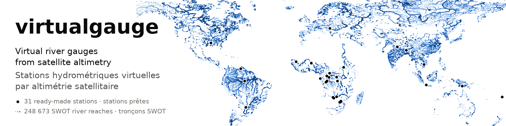
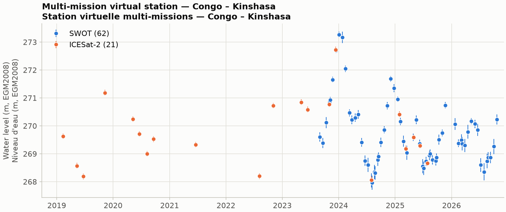
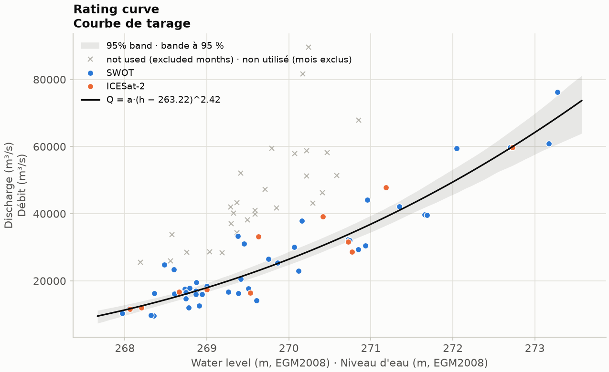
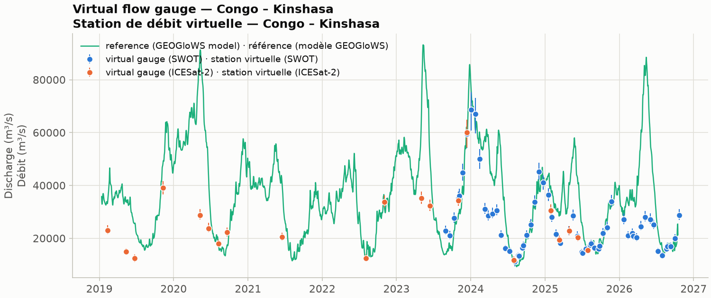
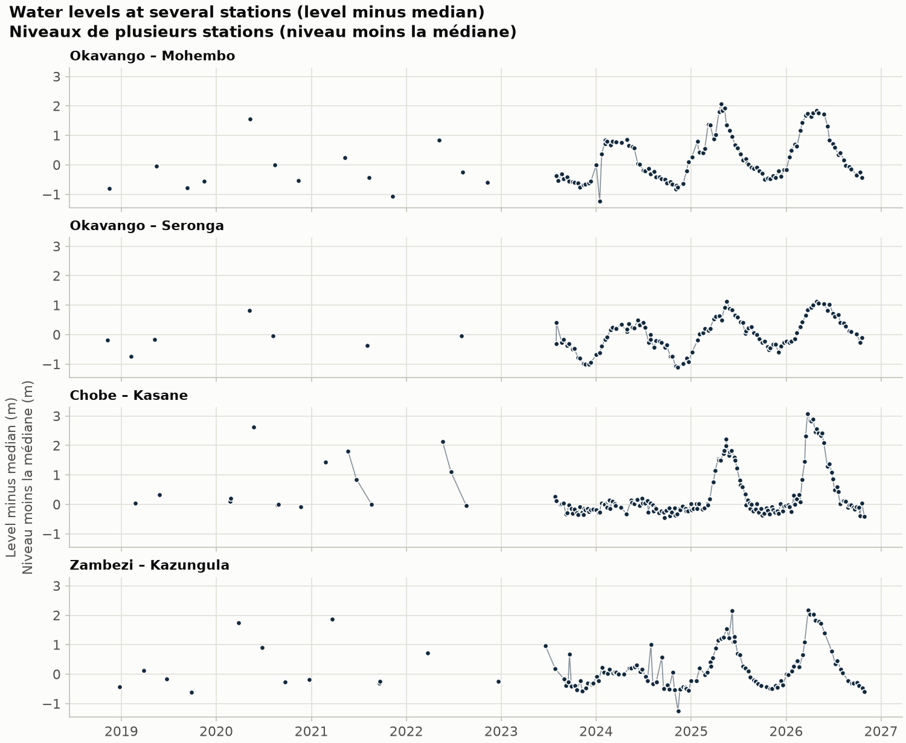
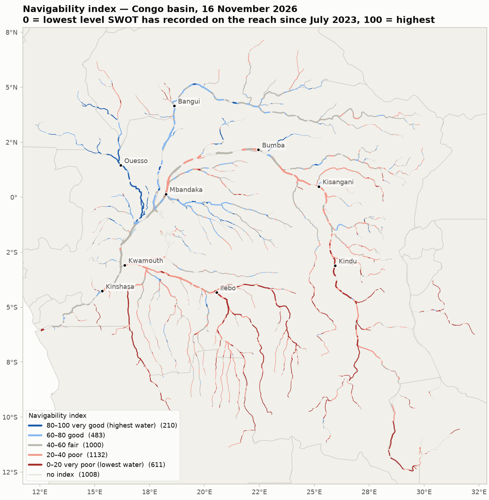

<picture>
  <source media="(prefers-color-scheme: dark)" srcset="docs/images/banner_dark.png">
  
</picture>

# Virtual river gauges from satellite altimetry · Stations hydrométriques virtuelles par altimétrie satellitaire

[](https://colab.research.google.com/github/simreaney/virtualgauge/blob/main/Virtual_River_Gauges_Student.ipynb)

Bilingual (English / French) teaching material for hydrologists in national services: build virtual river gauges from real ICESat-2 and SWOT satellite data, with worked examples on the **Congo at Kinshasa–Brazzaville (DR Congo)** and the **Rewa River (Fiji)**, six more Congo-basin stations, nine stations in **Botswana**, ready-made examples on every continent, and any river in the world.

Matériel pédagogique bilingue (anglais / français) pour les hydrologues des services nationaux : construire des stations hydrométriques virtuelles à partir de vraies données ICESat-2 et SWOT, avec des exemples sur le **Congo à Kinshasa–Brazzaville (RD Congo)** et la **rivière Rewa (Fidji)**, six autres stations du bassin du Congo, neuf stations au **Botswana**, des exemples prêts sur tous les continents, et toute rivière du monde.

## From satellite to discharge · Du satellite au débit

The Congo at Kinshasa–Brazzaville, drawn from the bundled data with no internet connection. · Le Congo à Kinshasa–Brazzaville, tracé avec les données fournies, sans connexion internet.

**1. Water levels · Niveaux d'eau** — `congo.levels()`\
SWOT (blue, from 2023) and ICESat-2 (orange, from 2019) combined into one record of the river's level.\
SWOT (bleu, depuis 2023) et ICESat-2 (orange, depuis 2019) réunis en une seule série de niveaux du fleuve.



**2. Rating curve · Courbe de tarage** — `congo.rating(exclude_months=[3, 4, 5, 6])`\
Each satellite level is paired with the GEOGloWS model discharge on the same day, and a curve Q = a·(h − h₀)ᵇ is fitted (NSE 0.88). March–June are left out (grey crosses) because the model is inconsistent with the river in those months. The grey band is the 95 % range of the curve.\
Chaque niveau satellitaire est associé au débit du modèle GEOGloWS du même jour, puis on ajuste une courbe Q = a·(h − h₀)ᵇ (NSE 0,88). Les mois de mars à juin sont exclus (croix grises) car le modèle est incohérent ces mois-là. La bande grise est l'intervalle à 95 % de la courbe.



**3. Virtual discharge · Débit virtuel** — `congo.discharge()`\
The curve turns every satellite level into a discharge (dots, with bars from the 95 % range), shown against the model (green line).\
La courbe transforme chaque niveau satellitaire en débit (points, avec barres tirées de l'intervalle à 95 %), comparé au modèle (ligne verte).



**Compare stations · Comparer des stations** — `vg.compare_stations(["okavango_mohembo", "okavango_seronga", "chobe_kasane", "zambezi_kazungula"])`\
The Okavango's flood peaks at Mohembo in April and reaches Seronga, smaller, a month later; the Chobe and the Zambezi peak in May.\
La crue de l'Okavango culmine à Mohembo en avril et atteint Seronga, plus faible, un mois plus tard ; le Chobe et le Zambèze culminent en mai.



## Four notebooks · Quatre notebooks

| Notebook | For · Pour |
|---|---|
| `Virtual_River_Gauges_Student.ipynb` | **Students** — results first, one line of code per step, questions to discuss, widgets, maps of the Congo, Botswana and the world. Uses the `virtualgauge` package. · **Étudiants** — résultats d'abord, une ligne de code par étape, questions, widgets, cartes. |
| `SWOT_Flood_Depth_Student.ipynb` | **Students, English only** — map a flood with SWOT: draw an area, compare a pass before and after the flood, and get the newly flooded area, the rise of the water and the flood depth. Worked examples: the Congo at Kinshasa (2023–24) and the Okavango Delta (2025). · **Étudiants, en anglais uniquement** — cartographier une crue avec SWOT. |
| `Congo_Navigability_Student.ipynb` | **Students, English or French** (the language of the computer, or chosen in the notebook) — download the SWOT levels of all 4,444 river reaches of the Congo basin, find each reach's lowest and highest recorded level, and map how navigable the rivers are today (0 = lowest water recorded, 100 = highest), along the main river, at the ports and through time; download the result as a GeoPackage for QGIS. · **Étudiants, en français ou en anglais** (la langue de l'ordinateur, ou au choix dans le notebook) — la navigabilité de tout le bassin du Congo avec SWOT, et le résultat en GeoPackage pour QGIS. |
| `Virtual_River_Gauges_DRC_Fiji.ipynb` | **Trainers / advanced** — the full method with all the code. · **Formateurs / avancés** — la méthode complète avec tout le code. |

[](https://colab.research.google.com/github/simreaney/virtualgauge/blob/main/SWOT_Flood_Depth_Student.ipynb) ← flood notebook
[](https://colab.research.google.com/github/simreaney/virtualgauge/blob/main/Congo_Navigability_Student.ipynb) ← navigability notebook

## Flood extent and depth with SWOT (English only)

```python
import virtualgauge as vg
area = vg.flood_area(polygon=[(15.25, -4.40), (15.60, -4.40), (15.60, -4.05), (15.25, -4.05)])  # (lon, lat)
area.passes("2023-08-15", "2024-02-15")      # SWOT passes over the area, and how much of it each saw (no login)
vg.earthdata_login()                         # free NASA Earthdata account, needed to download SWOT maps
flood = vg.flood_event(area, before="2023-09-04", after="2024-01-08")   # dates, or passes such as "003_111"
flood.extent()          # water before, after, newly flooded, water gone
flood.cleaning()        # which SWOT water levels are kept, and why the others are removed
flood.water_levels()    # rise of the water that was already there
flood.depth()           # flood depth on newly flooded land = SWOT water surface − ground (Copernicus DEM)
flood.summary(); flood.map(); flood.export()  # table, interactive map, CSV + GeoJSON + GeoTIFF in outputs/
vg.flood_explorer()     # draw an area on a map, find the passes around a flood date, map the flood
```

The water is the **SWOT L2 HR Raster 100 m** product (Version D). Searching for passes uses NASA's catalogue (CMR) and
needs no login; **downloading** each pass (20–70 MB, cut to your area and saved, so only once) needs a free
[NASA Earthdata login](https://urs.earthdata.nasa.gov/users/new). The ground is the **Copernicus GLO-30 DEM**, read
from AWS open data without a login. Both heights are above the EGM2008 geoid, so they can be subtracted. The extra
libraries come with `pip install "virtualgauge[flood]"` (earthaccess, xarray, h5netcdf, rasterio).

The two worked examples are `vg.flood_event("kinshasa_2024")` and `vg.flood_event("okavango_2025")`. Their pass
searches and ground heights are bundled; their four SWOT pass files are added with
`python tools/build_flood_examples.py` (needs an Earthdata login once), after which the examples run offline.

## Navigability of the whole Congo basin with SWOT (English or French)

```python
import virtualgauge as vg
congo = vg.river_survey("congo")   # SWOT levels of all 4,444 reaches of the basin: ~10 min the first time, no login
congo.coverage()                   # how many good SWOT levels each reach has
congo.cleaning()                   # which levels are removed, and why (quality flags, outliers, spikes)
congo.ranges()                     # lowest and highest recorded level of each reach, and the range between them
congo.navigability()               # index today = 100 × (latest − lowest) ÷ (highest − lowest), as a map
congo.map()                        # interactive map: click a river for its numbers
congo.profile()                    # from Kindu to the sea: range and index, reach by reach
congo.reach("13273000011")         # one reach (here Mbandaka): levels, lowest, highest, index
congo.ports()                      # the index through time at nine river ports
congo.history()                    # share of the river length in each band, month by month
congo.navigability("2025-08-01")   # the map on any date since late 2023
congo.export()                     # CSV, GeoPackage (opens styled in QGIS) and GeoJSON in outputs/
congo.download_geopackage()        # the GeoPackage to your computer (Colab: your Downloads folder)
```



Each reach is compared **with itself**: 0 means the river is as low as SWOT has recorded it there since July 2023
(poorest navigability), 100 as high (best). The levels come from Hydrocron (SWOT L2 HR RiverSP reach, Version D) with
no login; one file per reach is saved in `cache/survey_reaches/`, so an interrupted download continues where it
stopped and later runs only download again what is more than three days old (`update_days`). Before the lowest and
highest levels are taken, levels with poor quality flags, far from the reach's other levels, or spiking away from the
levels around them are removed, and reaches whose levels jump from pass to pass get no index (`vg.SurveyParams()`
lists every setting). A reach's index uses its latest good level of the last 30 days. Any list of reaches works too:
`vg.river_survey(reach_ids=[...])`. A copy of the whole Congo survey (downloaded 16 November 2026, 3 MB) is bundled,
so the notebook also runs offline; refresh it with `python tools/build_navigability_data.py`.

**Language.** The notebook's text, messages and figures are in English or French. Its *Language* cell is set to
`"auto"`: the language of the computer (on Colab, of the web browser), French if it is French and English otherwise;
`"en"` or `"fr"` choose one. In code: `vg.set_language("auto")`.

**GeoPackage.** `congo.export()` also writes `navigability_congo_<date>.gpkg`: a layer `reaches` (one line per reach
with its lowest, highest and latest level, range, index and band), a layer `ports`, and a QGIS style, so the rivers
open in QGIS already coloured by their index. `levels=True` adds a table of every SWOT level (about 30 MB more).

**As a web page.** `docs/navigability/` is the same map as a static site (plain HTML, CSS and JavaScript, Leaflet
included — no build step, no server code). It ships each reach's lowest and highest level, draws the map at once, then
your browser asks Hydrocron for the SWOT levels measured since and updates the index, judging new levels with the same
rules as the package (`tests/test_navigability_site.py` checks this). To publish it on GitHub Pages: *Settings → Pages →
Deploy from a branch →* `main`, folder `/docs`; the page is then at `https://<user>.github.io/virtualgauge/navigability/`.
To try it on your computer: `python -m http.server -d docs`, then open <http://localhost:8000/navigability/>. Rebuild
its data now and then with `python tools/build_navigability_site.py`, so the ranges include new record levels.

## The `virtualgauge` package · Le package `virtualgauge`

```python
import virtualgauge as vg
vg.set_language("both")                      # "en", "fr" or "both"
congo = vg.build_station("congo_kinshasa")   # or any 11-digit SWOT reach ID · ou tout identifiant SWOT
congo.levels()
congo.rating(exclude_months=[3, 4, 5, 6])
congo.discharge()
congo.export()
vg.explore()                                 # sliders · curseurs
vg.explore_map()                             # click a dot → graphs · cliquez sur un point → graphiques
vg.explore_map("botswana")                   # Botswana and its border rivers · le Botswana
vg.explore_map("world")                      # zoom in: every reach in view · zoomez : chaque tronçon de la vue
vg.explore_map(lat=-17.96, lon=178.43, radius_km=150)   # any region · toute région
vg.sites(region="botswana")                  # ready-made stations · stations prêtes
flood = vg.flood_event("kinshasa_2024")      # flood maps from SWOT (English only) · cartes de crue (en anglais)
congo_nav = vg.river_survey("congo")         # navigability of the whole Congo basin · navigabilité du bassin du Congo
```

It ships the real data (downloaded 3–4 November 2026) for 31 stations — the Congo basin, Botswana, Fiji and fourteen rivers on other continents, including the Karnali (Nepal) and the Cimanuk (West Java) — and an index of all 248,673 SWOT river reaches, so the student notebook works **offline**. Other reaches are downloaded on demand (no account needed). Ready-made stations: `vg.sites()`.

Il contient les vraies données (téléchargées les 3 et 4 novembre 2026) de 31 stations — bassin du Congo, Botswana, Fidji et quatorze fleuves d'autres continents, dont la Karnali (Népal) et la Cimanuk (Java occidental) — et l'index des 248 673 tronçons SWOT du monde : le notebook étudiant fonctionne **hors ligne**. Les autres tronçons sont téléchargés à la demande (sans compte).

## Install · Installation

**Your computer · Votre ordinateur**

```bash
pip install -e .              # the package (from this folder) · le package
pip install -e ".[flood]"     # + the flood-mapping libraries · + les bibliothèques de cartographie des crues
jupyter lab Virtual_River_Gauges_Student.ipynb
```

**Google Colab:** click the *Open in Colab* badge above, then *Runtime ▸ Run all*. The hidden setup cell installs the package from GitHub (`pip install git+https://github.com/simreaney/virtualgauge`). If Colab cannot install from GitHub, download `virtualgauge-0.1.1-py3-none-any.whl` from the [Releases page](https://github.com/simreaney/virtualgauge/releases) and upload it to Colab together with the notebook.
**Google Colab :** cliquez sur le badge *Open in Colab* ci-dessus, puis *Exécution ▸ Tout exécuter*. La cellule cachée installe le package depuis GitHub. Si Colab ne peut pas installer depuis GitHub, téléchargez le fichier `.whl` depuis la page [Releases](https://github.com/simreaney/virtualgauge/releases) et téléversez-le dans Colab avec le notebook.

**Anywhere else · Ailleurs :** `pip install git+https://github.com/simreaney/virtualgauge`

The trainer notebook only needs `pip install -r requirements.txt` · Le notebook formateur demande seulement `pip install -r requirements.txt`.

## Folder · Dossier

| Path · Chemin | What · Quoi |
|---|---|
| `src/virtualgauge/` | The package; `messages.py` holds every English/French text (for the francophone review) · tous les textes EN/FR |
| `src/virtualgauge/data/` | Bundled real data + `MANIFEST.json` (checksums, sources, dates) · données fournies |
| `tests/` | `pytest` — offline checks, including exact agreement with the trainer notebook · contrôles hors ligne |
| `tools/` | Rebuild the student notebooks (`build_student_notebook.py`, `build_flood_notebook.py`, `build_navigability_notebook.py`), the bundled data (incl. `build_flood_examples.py`, `build_navigability_data.py`), the location data, the README figures (`make_readme_figures.py`); `check_wheel.sh` · outils |
| `docs/images/` | README banner and figures, drawn offline from the bundled data · bannière et figures du README |
| `cache/`, `outputs/`, `data/` | Downloads, results, your own gauge files (see `data/README.md`) · téléchargements, résultats, vos fichiers |

## Data and credits · Données et remerciements

| Source | Access · Accès | Credit · Crédit |
|---|---|---|
| ICESat-2 ATL13 v007 (NASA/NSIDC) via SlideRule Earth | no login · sans identifiant | doi:10.5067/ATLAS/ATL13.007; SlideRule Earth (University of Washington / NASA) |
| SWOT L2 HR RiverSP, Version D (NASA/CNES, PO.DAAC) via Hydrocron | no login · sans identifiant | NASA/CNES, PO.DAAC |
| SWORD v17b river database (reach index) | bundled · fourni | Altenau et al. (2021), CC BY 4.0, doi:10.5281/zenodo.15299138 |
| GEOGloWS v2 retrospective streamflow (ECMWF) | no login · sans identifiant | GEOGloWS ECMWF Streamflow Model v2 |
| SWOT L2 HR Raster 100 m, Version D (NASA/CNES, PO.DAAC) — flood maps | free NASA Earthdata login · identifiant gratuit | doi:10.5067/SWOT-RASTER-D |
| Copernicus DEM GLO-30 (AWS open data) — flood depth | no login · sans identifiant | © DLR e.V. 2010–2014 and © Airbus Defence and Space GmbH 2014–2018, provided under COPERNICUS by the European Union and ESA |
| Botswana border (map outline) · frontière du Botswana | bundled · fourni | Natural Earth 1:50m, public domain · domaine public |
| Country borders of the Congo maps · frontières des cartes du Congo | bundled · fourni | Natural Earth 1:50m, public domain · domaine public |
| GRDC (optional · facultatif) | free registration · inscription gratuite | Global Runoff Data Centre, Koblenz — no redistribution · pas de rediffusion |
| DAHITI (optional · facultatif) | free API key · clé API gratuite | DGFI-TUM, CC BY 4.0 |

## Status · État

- Tested 2026-11-04: 28 offline tests pass on Python 3.13 (pandas 3) and on a Colab-like Python 3.12 (pandas 2.2, numpy 1.26, geopandas 1.0, ipywidgets 7.7); the student notebook runs offline from the installed wheel in both. The package reproduces the trainer notebook's results exactly.
  Testé le 2026-11-04 : 28 tests hors ligne réussis sous Python 3.13 et sous un Python 3.12 proche de Colab ; le notebook étudiant s'exécute hors ligne depuis le wheel installé. Le package reproduit exactement les résultats du notebook formateur.
- Not yet checked on real Google Colab, nor in VS Code's handling of the hidden setup cell. · Pas encore vérifié sur Colab ni dans VS Code.
- Flood maps (0.2.0, English only): 27 offline tests (synthetic rasters, a recorded NASA CMR answer, examples). The SWOT raster reader is written from the product documentation and **not yet checked against a real granule**; the examples' SWOT pass files are not yet bundled (`tools/build_flood_examples.py`, needs an Earthdata login). · Cartes de crue : lecteur raster SWOT pas encore vérifié sur un vrai fichier ; fichiers de passages des exemples pas encore fournis.
- Navigability (English and French): 29 offline tests (synthetic Hydrocron answers, cleaning, index, river network, the bundled Congo survey, French text, language detection, the GeoPackage and its QGIS style, the notebook builder). The GeoPackage was opened in QGIS 4.3 (rivers coloured by index, ports labelled); the language detection on Colab (the browser's language) has not been tried on Colab itself yet. The whole Congo basin (4,444 reaches) was downloaded twice on 2026-11-16 in about 9 minutes each, with no failure; 3,436 reaches have an index on that date. Lowest and highest levels are single measurements, so a reach with poor data (e.g. the Congo at Bumba, much dark water) can still have a doubtful range. · Navigabilité : 29 tests hors ligne ; tout le bassin du Congo téléchargé en 9 minutes environ.
- Where GEOGloWS is far from the flow measured nearby (Okavango at Mohembo 2.3×, Zambezi 3.8×, Niger 3×, White Nile 8×) the package warns in the Discharge tab; Botswana's own gauge records would make those curves usable. · Quand GEOGloWS s'écarte fortement du débit mesuré, le package le signale.
- The optional DAHITI and GRDC functions are untested without a real key or file. · Les fonctions DAHITI et GRDC ne sont pas testées sans vraie clé ou fichier.
- The French text should be reviewed by a francophone hydrologist (`src/virtualgauge/messages.py` and the notebooks). · Le texte français doit être relu par un hydrologue francophone.

## Licence

The code and notebooks are free software under the **GNU General Public License v3.0 or later** (see `LICENSE`). The bundled data keep their own terms (see *Data and credits* above).

Le code et les notebooks sont des logiciels libres sous **licence publique générale GNU v3.0 ou ultérieure** (voir `LICENSE`). Les données fournies gardent leurs propres conditions (voir *Données et remerciements*).
